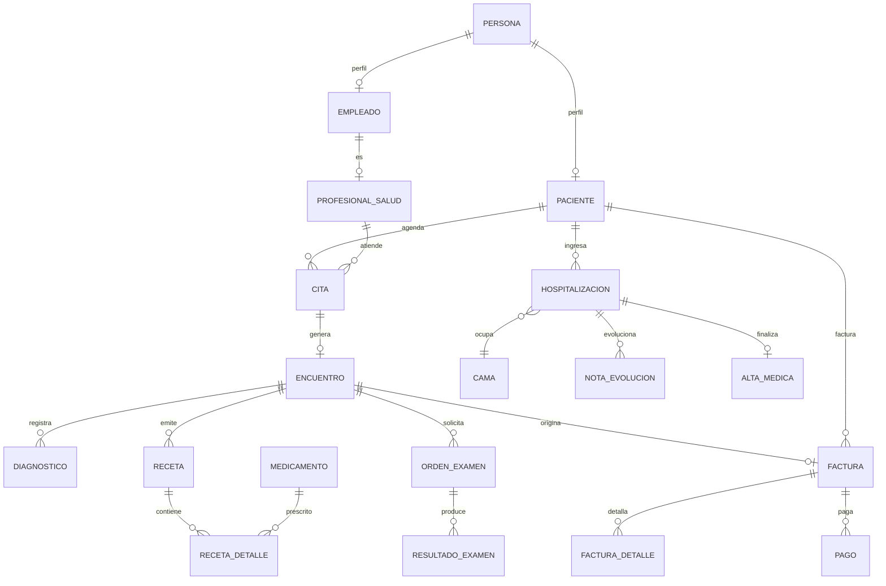

# MediList — Modelo de Entidades

Sistema de gestión para hospital / clínica.

**Convenciones:** `PK` = clave primaria, `FK` = clave foránea, `UK` = valor único. Atributos en `snake_case`; entidades en singular.

---

## Índice

1. [Personas, profesionales y seguridad](#1-personas-profesionales-y-seguridad)
2. [Infraestructura física](#2-infraestructura-física)
3. [Agenda y citas](#3-agenda-y-citas)
4. [Historia clínica y atención](#4-historia-clínica-y-atención)
5. [Hospitalización y cirugía](#5-hospitalización-y-cirugía)
6. [Farmacia e inventario](#6-farmacia-e-inventario)
7. [Facturación y seguros](#7-facturación-y-seguros)
8. [Soporte y auditoría](#8-soporte-y-auditoría)
9. [Diagrama del flujo clínico](#diagrama-del-flujo-clínico-principal)
10. [Reglas de negocio](#reglas-de-negocio-clave)

---

## 1. Personas, profesionales y seguridad

| Entidad | Propósito | Atributos clave |
|---|---|---|
| **Persona** | Datos de identidad comunes a pacientes y empleados | `id_persona` PK, `tipo_documento`, `numero_documento` UK, `nombres`, `apellidos`, `fecha_nacimiento`, `sexo`, `estado_civil`, `telefono`, `email`, `direccion`, `nacionalidad`, auditoría y borrado lógico |
| **Paciente** | Perfil clínico-administrativo | `id_paciente` PK, `id_persona` FK UK, `numero_historia` UK, `grupo_sanguineo`, `factor_rh`, `contacto_emergencia_nombre`, `contacto_emergencia_telefono`, `fecha_registro`, `activo` |
| **Empleado** | Vínculo laboral | `id_empleado` PK, `id_persona` FK UK, `codigo_empleado` UK, `id_servicio` FK, `cargo`, `fecha_ingreso`, `fecha_salida`, `tipo_contrato`, `estado` |
| **ProfesionalSalud** | Empleado habilitado para actos clínicos | `id_profesional` PK, `id_empleado` FK UK, `tipo_profesional` (médico, enfermero, etc.), `numero_licencia` UK, `firma_digital`, `activo` |
| **Especialidad** | Catálogo de especialidades | `id_especialidad` PK, `codigo` UK, `nombre`, `descripcion` |
| **ProfesionalEspecialidad** | Relación N:M profesional–especialidad | `id_profesional` FK, `id_especialidad` FK, `principal`, `fecha_certificacion` (PK compuesta) |
| **Usuario** | Credenciales de acceso | `id_usuario` PK, `id_persona` FK, `username` UK, `password_hash`, `email_verificado`, `ultimo_acceso`, `estado`, `token_version`, `mfa_habilitado` |
| **Rol / Permiso** | Control de acceso RBAC | `id_rol` PK, `nombre` UK, `descripcion`; `id_permiso` PK, `codigo` UK, `modulo`, `descripcion` |
| **UsuarioRol / RolPermiso** | Asignaciones N:M con vigencia | claves FK compuestas, `vigente_desde`, `vigente_hasta` |

### 1.1 Seguridad implementada en la versión actual

Esta versión implementa el núcleo de autenticación y autorización con las siguientes tablas:

| Tabla | Propósito | Atributos clave |
|---|---|---|
| `usuarios` | Cuenta de acceso | `id` PK, `username` UK, `email` UK, `password_hash`, `nombres`, `apellidos`, `activo`, `token_version`, `intentos_fallidos`, `bloqueado_hasta`, `ultimo_acceso` |
| `roles` | Agrupación de permisos | `id` PK, `codigo` UK, `nombre`, `descripcion` |
| `permisos` | Acción autorizable | `id` PK, `codigo` UK, `modulo`, `descripcion` |
| `usuario_roles` | Asignación N:M usuario–rol | `usuario_id` FK, `rol_id` FK, PK compuesta |
| `rol_permisos` | Asignación N:M rol–permiso | `rol_id` FK, `permiso_id` FK, PK compuesta |
| `refresh_tokens` | Sesiones de renovación | `id` PK, `usuario_id` FK, `token_hash` UK, `expira_en`, `revocado_en`, `ip`, `user_agent` |
| `auditoria` | Bitácora de seguridad | `id` PK, `usuario_id` FK, `username`, `accion`, `recurso`, `metodo`, `ruta`, `estado_http`, `ip`, `user_agent`, `trace_id`, `created_at` |
| `errores_aplicacion` | Errores agregados para observabilidad | `id` PK, `trace_id`, `servicio`, `instancia`, `componente`, `nivel`, `metodo`, `ruta`, `estado_http`, `codigo`, `mensaje`, `usuario_id` FK, `username`, `ip`, `user_agent`, `stack_trace`, `created_at` |

Reglas de seguridad:

1. `username` y `email` son únicos sin distinguir mayúsculas.
2. La contraseña se almacena únicamente como hash bcrypt (costo 12) y cumple una política mínima de 12 caracteres.
3. Tras 5 intentos fallidos la cuenta se bloquea 15 minutos; un administrador puede desbloquearla.
4. El access token JWT dura 15 minutos; el refresh token dura 7 días, rota en cada uso y se guarda como hash SHA-256.
5. La reutilización de un refresh token revocado invalida todas las sesiones del usuario.
6. Los permisos se validan en el middleware antes de ejecutar el caso de uso.
7. Los cambios de rol, contraseña o estado incrementan `token_version` y revocan los refresh tokens; el access token anterior deja de ser válido de inmediato.
8. Un administrador puede forzar la revocación inmediata de todas las sesiones de un usuario.
9. Se auditan inicios de sesión, bloqueos, refresh, cambios de contraseña, escrituras, accesos denegados y consultas a los paneles de auditoría y errores.
10. Los errores internos y pánicos se registran con `trace_id` y `instancia` en `errores_aplicacion` y en logs JSON; el mismo identificador se devuelve al cliente en `X-Request-ID` y `request_id`.
11. La auditoría y los errores agregados comparten `trace_id`, lo que permite correlacionar un evento de seguridad con su fallo técnico. La retención se aplica automáticamente según la configuración.

---

## 2. Infraestructura física

| Entidad | Propósito | Atributos clave |
|---|---|---|
| **Sede** | Sucursal o establecimiento | `id_sede` PK, `nombre`, `direccion`, `ciudad`, `telefono`, `ruc`, `activa` |
| **Servicio** | Departamento o área (consulta externa, emergencia, laboratorio, hospitalización) | `id_servicio` PK, `id_sede` FK, `nombre`, `tipo`, `piso`, `activo` |
| **Consultorio** | Espacio para consulta ambulatoria | `id_consultorio` PK, `id_servicio` FK, `codigo`, `piso`, `estado` |
| **Habitacion** | Cuarto de hospitalización | `id_habitacion` PK, `id_servicio` FK, `numero`, `tipo` (individual, compartida, UCI), `piso`, `estado` |
| **Cama** | Unidad ocupable dentro de una habitación | `id_cama` PK, `id_habitacion` FK, `codigo`, `tipo`, `estado` (disponible, ocupada, mantenimiento, higienización), UK(`id_habitacion`, `codigo`) |
| **Quirofano** | Sala quirúrgica | `id_quirofano` PK, `id_sede` FK, `nombre`, `estado` |

---

## 3. Agenda y citas

| Entidad | Propósito | Atributos clave |
|---|---|---|
| **HorarioProfesional** | Plantilla de disponibilidad | `id_horario` PK, `id_profesional` FK, `id_consultorio` FK, `dia_semana`, `hora_inicio`, `hora_fin`, `duracion_slot_min`, `vigente_desde`, `vigente_hasta` |
| **Cita** | Reserva de atención | `id_cita` PK, `codigo` UK, `id_paciente` FK, `id_profesional` FK, `id_consultorio` FK, `fecha_hora_inicio`, `duracion_min`, `tipo` (primera vez, control, urgencia), `motivo`, `estado`, `id_cita_origen` FK (reprogramación), `creada_por` FK |
| **ListaEspera** | Pacientes pendientes de cupo | `id_espera` PK, `id_paciente` FK, `id_especialidad` FK, `prioridad`, `fecha_solicitud`, `estado` |
| **BloqueoAgenda** | Ausencias del profesional | `id_bloqueo` PK, `id_profesional` FK, `fecha_inicio`, `fecha_fin`, `motivo` |

**Estados de la cita:** `programada → confirmada → atendida`, con salidas alternas `no_asistio`, `cancelada`, `reprogramada`.

---

## 4. Historia clínica y atención

| Entidad | Propósito | Atributos clave |
|---|---|---|
| **Antecedente** | Antecedentes patológicos, quirúrgicos, familiares | `id_antecedente` PK, `id_paciente` FK, `tipo`, `descripcion`, `fecha` |
| **Alergia** | Alergias del paciente | `id_alergia` PK, `id_paciente` FK, `alergeno`, `tipo_reaccion`, `severidad`, `activa` |
| **EncuentroAtencion** | Evento clínico central (consulta, emergencia, telemedicina, internación) | `id_encuentro` PK, `id_paciente` FK, `id_cita` FK (opcional), `id_profesional` FK, `id_servicio` FK, `tipo`, `fecha_hora_inicio`, `fecha_hora_fin`, `motivo_consulta`, `enfermedad_actual`, `examen_fisico`, `plan`, `estado` |
| **SignosVitales** | Medición puntual | `id_signos` PK, `id_encuentro` FK, `fecha_hora`, `temperatura`, `fc`, `fr`, `ta_sistolica`, `ta_diastolica`, `spo2`, `peso`, `talla`, `imc`, `escala_dolor`, `registrado_por` FK |
| **CatalogoCIE10** | Catálogo de diagnósticos | `codigo` PK, `descripcion`, `capitulo` |
| **Diagnostico** | Diagnóstico del encuentro | `id_diagnostico` PK, `id_encuentro` FK, `codigo_cie10` FK, `tipo` (presuntivo, definitivo, secundario), `descripcion`, `fecha` |
| **Procedimiento** | Procedimiento realizado | `id_procedimiento` PK, `id_encuentro` FK, `codigo`, `descripcion`, `fecha`, `id_profesional` FK |
| **Receta** | Prescripción emitida | `id_receta` PK, `id_encuentro` FK, `id_profesional` FK, `fecha`, `estado` (emitida, dispensada, anulada), `indicaciones_generales` |
| **DetalleReceta** | Líneas de la receta | `id_detalle` PK, `id_receta` FK, `id_medicamento` FK, `dosis`, `via`, `frecuencia`, `duracion_dias`, `cantidad`, `indicaciones` |
| **OrdenExamen** | Solicitud de estudios | `id_orden` PK, `id_encuentro` FK, `id_profesional` FK, `tipo` (laboratorio, imagen, patología), `prioridad`, `estado`, `fecha` |
| **DetalleOrdenExamen** | Exámenes solicitados | `id_detalle` PK, `id_orden` FK, `id_examen` FK, `indicaciones` |
| **CatalogoExamen** | Catálogo de pruebas | `id_examen` PK, `codigo` UK, `nombre`, `tipo`, `valores_referencia`, `tiempo_entrega_horas` |
| **ResultadoExamen** | Resultado validado | `id_resultado` PK, `id_detalle_orden` FK, `fecha`, `valor`, `unidad`, `rango_referencia`, `interpretacion`, `archivo_url`, `validado_por` FK |
| **Derivacion** | Referencia a otra especialidad | `id_derivacion` PK, `id_encuentro_origen` FK, `id_especialidad_destino` FK, `id_profesional_destino` FK, `motivo`, `prioridad`, `estado`, `fecha` |
| **DocumentoClinico** | Consentimientos, informes, adjuntos | `id_documento` PK, `id_paciente` FK, `id_encuentro` FK, `tipo`, `archivo_url`, `hash`, `fecha` |

---

## 5. Hospitalización y cirugía

| Entidad | Propósito | Atributos clave |
|---|---|---|
| **Hospitalizacion** | Estancia hospitalaria | `id_hospitalizacion` PK, `id_paciente` FK, `id_encuentro` FK (opcional), `id_cama_actual` FK, `id_profesional_tratante` FK, `fecha_hora_ingreso`, `fecha_hora_alta`, `tipo_ingreso`, `motivo`, `estado` |
| **TrasladoCama** | Historial de cambios de cama | `id_traslado` PK, `id_hospitalizacion` FK, `id_cama_origen` FK, `id_cama_destino` FK, `fecha`, `motivo` |
| **NotaEvolucion** | Evolución médica (SOAP) | `id_nota` PK, `id_hospitalizacion` FK, `id_profesional` FK, `fecha`, `subjetivo`, `objetivo`, `analisis`, `plan` |
| **RegistroEnfermeria** | Hoja de enfermería por turno | `id_registro` PK, `id_hospitalizacion` FK, `id_profesional` FK, `turno`, `fecha`, `observaciones` |
| **AdministracionMedicamento** | Registro de dosis administradas | `id_administracion` PK, `id_hospitalizacion` FK, `id_detalle_receta` FK, `fecha_hora`, `dosis`, `via`, `id_enfermero` FK, `estado`, `observacion` |
| **Cirugia** | Intervención quirúrgica | `id_cirugia` PK, `id_hospitalizacion` FK (opcional), `id_quirofano` FK, `id_cirujano_principal` FK, `nombre`, `fecha_inicio`, `fecha_fin`, `tipo`, `estado` |
| **EquipoQuirurgico** | Personal de la cirugía | `id_cirugia` FK, `id_profesional` FK, `rol` (cirujano, anestesiólogo, instrumentador, ayudante), PK compuesta |
| **AltaMedica** | Cierre de la hospitalización | `id_alta` PK, `id_hospitalizacion` FK UK, `fecha`, `tipo` (domicilio, traslado, fallecimiento, voluntario), `diagnostico_egreso`, `recomendaciones`, `id_profesional` FK |

---

## 6. Farmacia e inventario

| Entidad | Propósito | Atributos clave |
|---|---|---|
| **Medicamento** | Catálogo farmacológico | `id_medicamento` PK, `codigo` UK, `nombre_generico`, `nombre_comercial`, `presentacion`, `concentracion`, `forma_farmaceutica`, `via`, `requiere_receta`, `controlado`, `activo` |
| **Lote** | Trazabilidad por lote | `id_lote` PK, `id_medicamento` FK, `numero_lote`, `fecha_vencimiento`, `id_proveedor` FK, `costo_unitario`, UK(`id_medicamento`, `numero_lote`, `fecha_vencimiento`) |
| **Stock** | Existencias por sede | `id_stock` PK, `id_lote` FK, `id_sede` FK, `cantidad`, `stock_minimo`, `ubicacion`, UK(`id_lote`, `id_sede`) |
| **MovimientoInventario** | Kardex de entradas/salidas | `id_movimiento` PK, `id_stock` FK, `tipo` (entrada, salida, ajuste, devolución, baja), `cantidad`, `motivo`, `referencia`, `id_usuario` FK, `fecha` |
| **Dispensacion** | Entrega de medicamentos | `id_dispensacion` PK, `id_receta` FK, `id_farmaceutico` FK, `fecha`, `estado` |
| **DetalleDispensacion** | Ítems entregados | `id_detalle` PK, `id_dispensacion` FK, `id_medicamento` FK, `id_lote` FK, `cantidad` |
| **Proveedor / OrdenCompra / DetalleOrdenCompra** | Abastecimiento (módulo de compras) | proveedor, fechas, cantidades, precios, estado de recepción |

---

## 7. Facturación y seguros

| Entidad | Propósito | Atributos clave |
|---|---|---|
| **Aseguradora** | Entidad de seguro | `id_aseguradora` PK, `nombre`, `ruc`, `contacto` |
| **PlanSeguro** | Plan contratado | `id_plan` PK, `id_aseguradora` FK, `nombre`, `cobertura_pct`, `copago`, `deducible` |
| **CoberturaPaciente** | Póliza vigente del paciente | `id_cobertura` PK, `id_paciente` FK, `id_plan` FK, `numero_poliza`, `titular`, `vigente_desde`, `vigente_hasta`, `estado` |
| **Tarifa** | Precio de servicios | `id_tarifa` PK, `codigo` UK, `descripcion`, `tipo`, `precio`, `vigente_desde`, `vigente_hasta` |
| **Factura** | Documento financiero | `id_factura` PK, `numero` UK, `id_paciente` FK, `id_encuentro` FK, `id_hospitalizacion` FK, `id_cobertura` FK, `fecha_emision`, `subtotal`, `descuento`, `impuesto`, `total`, `estado` |
| **DetalleFactura** | Conceptos facturados | `id_detalle` PK, `id_factura` FK, `id_tarifa` FK, `descripcion`, `cantidad`, `precio_unitario`, `subtotal` |
| **Pago** | Abonos a la factura | `id_pago` PK, `id_factura` FK, `fecha`, `monto`, `metodo`, `referencia`, `id_usuario_caja` FK |
| **AutorizacionSeguro** | Aprobación previa del seguro | `id_autorizacion` PK, `id_cobertura` FK, `id_encuentro` FK, `numero_autorizacion`, `estado`, `monto_aprobado` |

---

## 8. Soporte y auditoría

| Entidad | Propósito | Atributos clave |
|---|---|---|
| **Notificacion** | Avisos a usuarios | `id_notificacion` PK, `id_usuario` FK, `titulo`, `mensaje`, `tipo`, `leida`, `fecha` |
| **Auditoria** | Trazabilidad de cambios | `id_auditoria` PK, `id_usuario` FK, `tabla`, `accion`, `registro_id`, `datos_anteriores` JSON, `datos_nuevos` JSON, `ip`, `fecha` |
| **ErrorAplicacion** | Error correlacionable para agregación de logs | `id_error` PK, `trace_id`, `servicio`, `componente`, `nivel`, `metodo`, `ruta`, `estado_http`, `codigo`, `mensaje`, `id_usuario` FK, `username`, `ip`, `user_agent`, `stack_trace`, `created_at` |
| **Configuracion** | Parámetros del sistema | `clave` PK, `valor`, `descripcion`, `modulo` |

---

## Diagrama del flujo clínico principal

---

## Reglas de negocio clave

1. **Historia clínica inmutable:** no se actualiza ni elimina; las correcciones se hacen con notas de rectificación auditadas.
2. **Una cama, un paciente:** índice único parcial para garantizar que solo exista una hospitalización activa por cama.
3. **Sin doble reserva:** restricción única sobre profesional + fecha/hora de cita activa.
4. **Cobertura vigente:** la póliza debe estar vigente en la fecha del servicio para aplicar seguro.
5. **Facturas anulables, no borrables:** anulación con motivo, usuario y fecha; el pago genera movimientos inmutables.
6. **Farmacia FEFO:** salida de inventario por lote con fecha de vencimiento más próxima.
7. **Controlados:** medicamentos marcados como controlados exigen receta especial y trazabilidad completa.
8. **Multi-sede:** servicios, camas, stock y caja siempre asociados a una sede.
9. **Auditoría obligatoria** en tablas clínicas, financieras y de seguridad.
10. **Tipos de datos:** montos en `DECIMAL(12,2)`, fechas en UTC, documentos y firmas con hash.
11. **Contraseñas:** nunca se almacenan ni registran en texto plano; solo el hash bcrypt.
12. **Tokens:** el refresh token se almacena hasheado, rota en cada uso y se revoca al cerrar sesión o cambiar credenciales.
13. **Mínimo privilegio:** cada rol recibe solo los permisos necesarios para su función.
14. **Trazabilidad:** toda operación de escritura autenticada, todo intento de acceso denegado y toda consulta a los paneles de auditoría/errores queda en `auditoria` con su `trace_id`.
15. **Revocación inmediata:** el claim `ver` del JWT debe coincidir con `usuarios.token_version`; cualquier cambio de rol, contraseña, estado o revocación explícita invalida los access tokens vigentes.
16. **Observabilidad:** los errores internos se escriben simultáneamente en stdout JSON y en `errores_aplicacion`, correlacionados por `trace_id` e identificados por `instancia`; nunca incluyen contraseñas, tokens ni cuerpos de solicitud.
